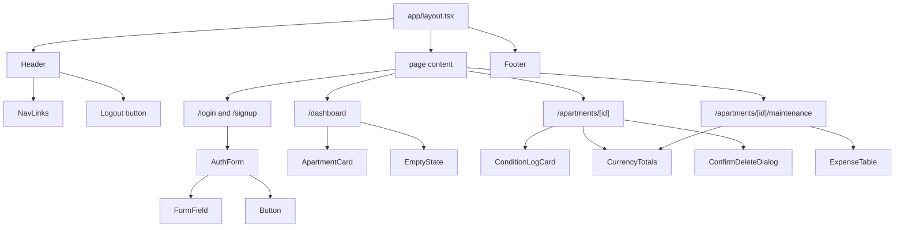
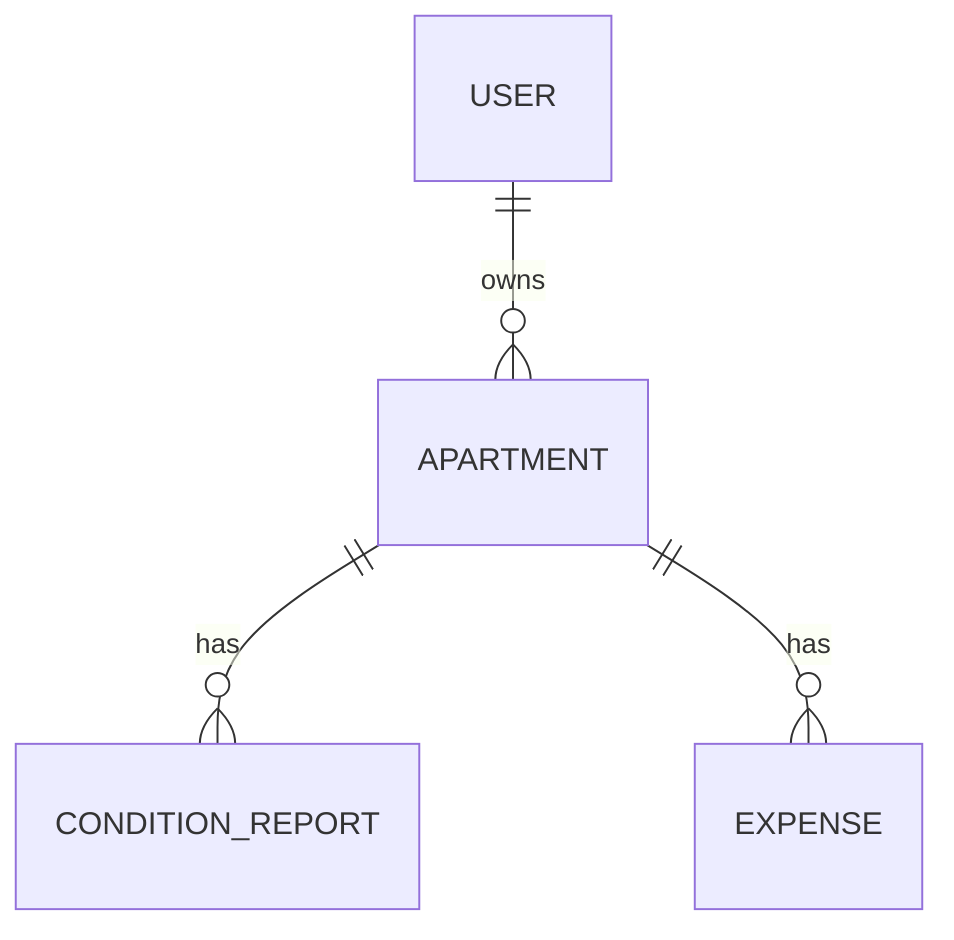

# RentLog: Architecture and Planning (Week 03)

**Team 12:** Elizabeth Greeff, Thubelihle Dlamini, Mackison Jean Pierre, Britney Maulana
**Week 03 leader:** Thubelihle Dlamini · **Week 04 leader:** Elizabeth Greeff
**Status:** Draft for team review. Items marked **✅ Agreed** were decided in the Week 03 meeting; items marked **💡 Proposed** are suggestions awaiting the team's 👍 or edits in Teams.

This document complements [`spec.md`](../spec.md) and feeds [`.github/copilot-instructions.md`](../.github/copilot-instructions.md). Each owner is welcome to edit their section on this branch.

---

## 1. Stack

| Area | Decision | Status |
| --- | --- | --- |
| Framework | Next.js App Router, TypeScript (strict), Tailwind CSS. The app lives in `RentLog/`. | ✅ Agreed (course requirement) |
| Database | **MongoDB** | ✅ Agreed |
| Hosting and ODM | MongoDB Atlas free tier with **Mongoose** for schemas | 💡 Proposed |
| Auth | **Auth.js** (our own User model, admin role, but we build login, signup and password reset) **or Clerk** (ready-made screens and password reset, roles in user metadata) | 🗳️ Team vote open |
| Photo and receipt files | Store the files in Vercel Blob; MongoDB keeps only the URLs | 💡 Proposed |
| Deployment | Vercel | ✅ Agreed (course requirement) |

## 2. MVP routes

| Route | Purpose | Target week | Status |
| --- | --- | --- | --- |
| `/` | Landing page | Week 04 | 💡 |
| `/login`, `/signup` | Sign in and create an account | Week 04 | ✅ Login/Signup agreed |
| Logout | Button in the Header that signs out and returns to `/` | Week 04 | ✅ Logout agreed |
| `/dashboard` | Protected home: the user's apartments and a summary | Week 04 (empty shell) | ✅ Dashboard agreed |
| `/apartments`, `/apartments/new`, `/apartments/[id]`, `/apartments/[id]/edit` | Apartment (rental) create, read, update, delete | Week 05 | ✅ Rentals agreed |
| `/apartments/[id]/condition`, `/condition/[reportId]` | Move-in and move-out condition logs with photos | Week 05 | 💡 |
| `/apartments/[id]/maintenance`, `/apartments/[id]/maintenance/new` | Maintenance expense ledger and add expense | Week 05 | ✅ Maintenance agreed |
| `/account` | View, update or delete profile | Week 05 | 💡 |
| `/admin` | Admin view | Phase 2 (optional) | 💡 Spec currently scopes the MVP to single renters |

## 3. Reusable components 💡

**✅ Agreed as essential:** `Header`, `Footer`.
**💡 Proposed from the spec:** `NavLinks`, `AuthForm` (shared by login and signup), `ApartmentCard`, `ConditionLogCard`, `ExpenseTable`, `CurrencyTotals`, `EmptyState`, `ConfirmDeleteDialog` (spec FR-014), `FormField` (label + error message), `Button`.

## 4. Data model

> **Owner: Mackison** (entities, relationships and final fields). The fields below are input for him to adjust.

**Entities:** ✅ User, Apartment, Expense · 💡 ConditionReport (move-in and move-out). Photos and receipts are stored as lists of file URLs inside ConditionReport and Expense, which keeps us at **4 entities**.

| Entity | Proposed key fields |
| --- | --- |
| **User** | `name`, `email`, password hash or auth-provider id, `role` (`user` \| `admin`), `createdAt` |
| **Apartment** | `ownerId` → User, `nickname`, `address`, `landlordName`, `landlordEmail`, `leaseStart`, `leaseEnd`, `depositAmountCents`, `currency` |
| **ConditionReport** | `apartmentId` → Apartment, `ownerId`, `type` (`move-in` \| `move-out`), `date`, `observations[]` → `{ room, condition, notes, photoUrls[] }` |
| **Expense** | `apartmentId` → Apartment, `ownerId`, `date`, `description`, `category`, `amountCents` (positive integer), `currency`, `receiptUrls[]`, `reimbursementStatus` |

**Why these choices:**
- **Embedded observations.** A report has a small, fixed set of rooms that are always read together, so they live inside the report document.
- **Money as integer cents.** Storing `amountCents` avoids floating-point rounding errors, and totals are kept separate per `currency` (spec FR-009).
- **`ownerId` on every document.** Every query can filter by the signed-in user, so nobody can read another renter's records (spec FR-002).

## 5. Design system

> **Owner: Elizabeth.** Colour palette, typography, layout and spacing conventions, and shared UI approach. The team will review her proposal and suggest edits. *(Section to be completed by Elizabeth.)*

## 6. Proposed issues and ownership 💡

| # | Issue | Type | Suggested owner | Milestone |
| --- | --- | --- | --- | --- |
| 1 | MongoDB connection (`lib/db.ts`) and environment setup | backend | Mackison | Week 04 |
| 2 | User model and auth: signup, login, logout | backend | Mackison | Week 04 |
| 3 | Login and Signup pages with form validation | frontend | Thubelihle | Week 04 |
| 4 | Header (with logout), Footer and layout shell | frontend | Elizabeth | Week 04 |
| 5 | Design tokens in `globals.css` and base UI components | frontend | Elizabeth | Week 04 |
| 6 | Protected dashboard page with empty state | frontend | Britney | Week 04 |
| 7 | Shared TypeScript types in `types/` | backend | Mackison + all | Week 04 |
| 8 | Apartment model and CRUD API and pages | full-stack | Elizabeth | Week 05 |
| 9 | ConditionReport model and condition log pages | full-stack | Thubelihle | Week 05 |
| 10 | Expense model, totals by currency, maintenance ledger | full-stack | Britney | Week 05 |

**Existing board items:** fold *Delete / Update / View account details* into issue 2 or `/account`. *Payment* isn't in the spec, since RentLog tracks expenses rather than taking payments, so close or rename it. Clarify what *Deposits* covers.

## 7. Dependencies 💡

1. **Shared types (#7) and the database connection (#1) come first.** Everything else imports them.
2. **The User model and auth (#2)** come next. The login, signup, logout and dashboard pages (#3, #4, #6) need it.
3. **Design tokens (#5)** have no dependencies and can start on day one.
4. **All Week 05 models (#8–#10)** need the database connection and the user id (`ownerId`).

## 8. Team workflow 💡

- **Branches:** one per issue, named `feature/<short-name>` (for example `feature/login-page`). No direct pushes to `main`.
- **Pull requests:** at least one teammate reviews before merging, within 24 hours. Tag the reviewer in Teams.
- **Daily check-in:** a post in the Teams channel by **18:00 UTC** with *Done / Next / Blockers*.
- **Blocked for more than a day?** Say so in the channel straight away.
- **Before opening a PR:** `npm run lint` and `npm run build` must pass.
